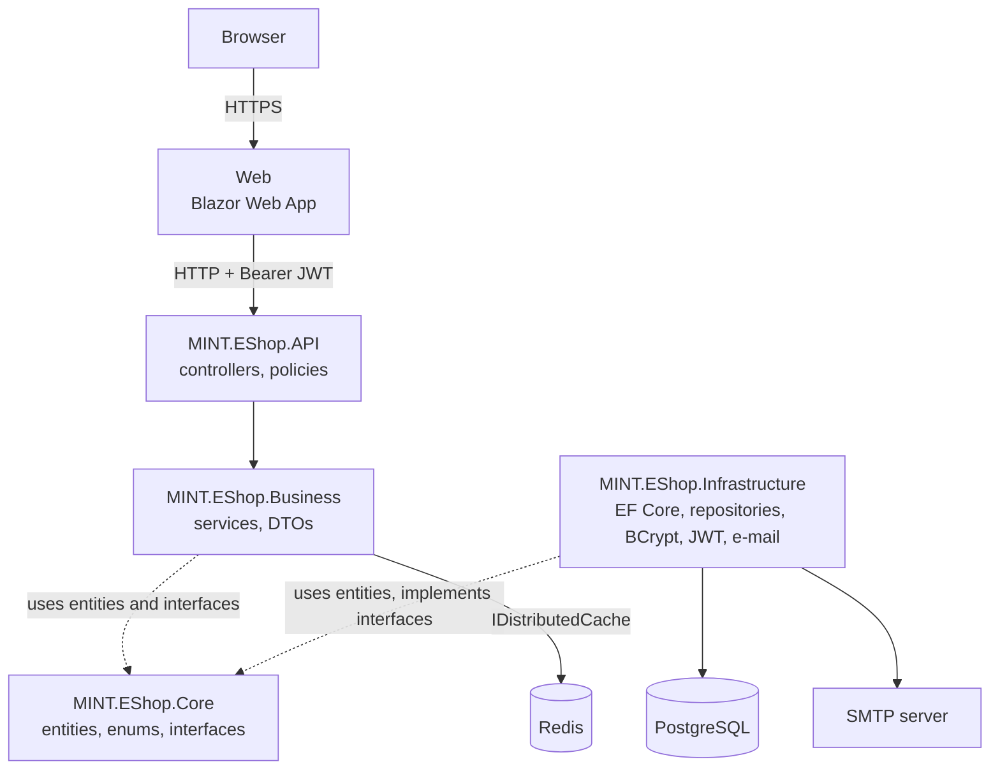

# Shopik

**Shopik** is an online electronics store built with **C# / .NET 9**: an ASP.NET Core Web API, a Blazor Web App front end and a PostgreSQL database. Customers browse the catalogue, filter products, keep a wishlist and a cart, and place orders with delivery and payment options. Managers maintain the catalogue, and administrators manage staff roles.

> The user interface is in Ukrainian.

## Features

**Customers**
- Registration with e-mail confirmation (6-digit code, valid for 5 minutes, can be resent)
- Sign in and sign out; profile editing (name and phone number)
- Product catalogue with search suggestions and filters by price, category and brand
- Product page with stock status and similar products
- Wishlist
- Cart stored in the browser (works for guests too), limited by the available stock
- Checkout with delivery by Nova Poshta or Ukrposhta and payment now or on delivery
- "My orders" page with status tabs; a pending order can be cancelled and its items return to stock

**Managers**
- Create, edit and delete products, categories and producers

**Administrators**
- View users, search and filter them by role
- Promote a customer to manager, demote a manager, delete accounts

Pages for managers and administrators look like a "page not found" to other users, so their existence is not revealed.

## Tech stack

| Area | Technology |
|---|---|
| Language and platform | C#, .NET 9 |
| API | ASP.NET Core Web API, Swagger (Swashbuckle) |
| Front end | Blazor Web App (Interactive Server), custom CSS, a little JavaScript for `fetch` and `localStorage` |
| Data | PostgreSQL, Entity Framework Core (Npgsql), migrations |
| Cache | Redis (pending registrations) |
| Security | JWT access and refresh tokens, BCrypt password hashing, role-based policies |
| E-mail | MailKit (SMTP) |
| Logging | Serilog (console and a PostgreSQL table) |
| Mapping | AutoMapper |

## Architecture

The solution consists of five projects. Dependencies point towards the core: business logic and infrastructure meet only through the interfaces declared in `MINT.EShop.Core`.



| Project | Responsibility |
|---|---|
| `MINT.EShop.Core` | Entities, enums, repository and service interfaces, options |
| `MINT.EShop.Business` | Services with business rules, DTOs, AutoMapper profile |
| `MINT.EShop.Infrastructure` | `AppDbContext`, entity configurations, migrations, repositories, Unit of Work, password hashing, JWT provider, e-mail sender, data seeder |
| `MINT.EShop.API` | REST controllers, authorization policies, global exception handler, composition root |
| `Web` | Blazor pages and components, endpoints that the browser calls, token refresh |

### Authentication

- The API issues a short-lived **access token** (JWT) and a **refresh token** valid for 7 days. Refresh tokens are stored as sessions in the database and are rotated on every refresh; signing out deletes the session.
- The Web app works as a **backend for the browser**: tokens are kept in `HttpOnly`, `Secure`, `SameSite=Strict` cookies, and requests that need a token go through the Web app's own endpoints, which call the API and refresh the token when needed. The browser never calls the protected API directly.
- Until the e-mail is confirmed, registration data (with an already hashed password) is kept in Redis for 5 minutes; the account is created in the database only after the correct code is entered.

## Getting started

### Prerequisites

- [.NET 9 SDK](https://dotnet.microsoft.com/download)
- [Docker](https://www.docker.com/) for PostgreSQL and Redis (or local installations of both)
- An SMTP account for sending confirmation e-mails

### 1. Start PostgreSQL and Redis

```bash
docker run -d --name shopik-postgres -e POSTGRES_PASSWORD=<password> -e POSTGRES_DB=ESHOP -p 5432:5432 postgres:17
```

```bash
docker run -d --name shopik-redis -p 6379:6379 redis:7
```

### 2. Configure the API

Secrets are stored with [User Secrets](https://learn.microsoft.com/aspnet/core/security/app-secrets). From the repository root:

```bash
dotnet user-secrets --project MINT.EShop.API set "ConnectionStrings:PostgreSQL" "Host=localhost;Port=5432;Database=ESHOP;Username=postgres;Password=<password>"
```

```bash
dotnet user-secrets --project MINT.EShop.API set "ConnectionStrings:Redis" "localhost:6379"
```

```bash
dotnet user-secrets --project MINT.EShop.API set "JwtSettings:SecretKey" "<at least 32 random characters>"
```

```bash
dotnet user-secrets --project MINT.EShop.API set "JwtSettings:ExpiresInMinutes" "15"
```

```bash
dotnet user-secrets --project MINT.EShop.API set "EmailSettings:Password" "<SMTP password>"
```

The first administrator and manager are created on the first start, when the database has no users yet. Set their data in `AdminSetup` and `ManagerSetup` (`Email`, `Password`, `FirstName`, `PhoneNumber`), for example:

```bash
dotnet user-secrets --project MINT.EShop.API set "AdminSetup:Email" "admin@example.com"
```

`DatabaseType` in `appsettings.json` selects the database: `1` for PostgreSQL, `0` for the EF Core in-memory provider.

### 3. Configure the Web app

```bash
dotnet user-secrets --project Web set "JwtSettings:AccessToken" "access_token"
```

```bash
dotnet user-secrets --project Web set "JwtSettings:RefreshToken" "refresh_token"
```

```bash
dotnet user-secrets --project Web set "JwtSettings:ExpiresInMinutes" "15"
```

`AccessToken` and `RefreshToken` are the names of the cookies. `BaseUrl` in `Web/appsettings.json` points to the API (`https://localhost:7254`).

### 4. Run

Start the API first. Database migrations are applied automatically on start-up.

```bash
dotnet run --project MINT.EShop.API --launch-profile https
```

Then start the Web app in a second terminal:

```bash
dotnet run --project Web --launch-profile https
```

| Application | URL |
|---|---|
| Web app | <https://localhost:7136> |
| API | <https://localhost:7254> |
| Swagger (Development only) | <https://localhost:7254/swagger> |

In Visual Studio you can start both at once: **Solution → Configure Startup Projects → Multiple startup projects**.

## Project structure

```
MINT.EShop.sln
├── MINT.EShop.Core            entities, enums, interfaces, options
├── MINT.EShop.Business        services, DTOs, mapping
├── MINT.EShop.Infrastructure  EF Core, configurations, migrations, repositories
├── MINT.EShop.API             controllers, extensions, middleware
└── Web                        Blazor pages, widgets, services, wwwroot
```

## Roadmap

- Online payment through a payment provider
- Password reset (the interface is ready, the server part is not)
- Order processing page for managers (the API endpoints already exist)
- Catalogue sorting and server-side pagination
- Uploading product images instead of using links
- Discounts and automated tests
